# GameBEX

**Bring your ROM site. Bring player two.**

Turn a compatible ROM site's catalog into a game library on your phone. Give
[our prompt](https://jeffnash.github.io/GameBEX/#prompt) and the site's address to
your coding agent. It builds a source plugin; you import it, browse, and press
Play. GameBEX handles the download, disc prep, emulator setup, and launch.

Then invite someone over. **Stream turns local multiplayer into two-phone
co-op:** one phone runs the game, the other gets its picture and sound and sends
player two's controls back. The joining phone only needs GameBEX, not its own
game, emulator, or matching core. Both phones stay on the same Wi-Fi.

We supply the prompt, not the ROMs. Bring a site you trust and games you legally
own **and have the right to download**. Your source, your responsibility. At your
own risk. ;)

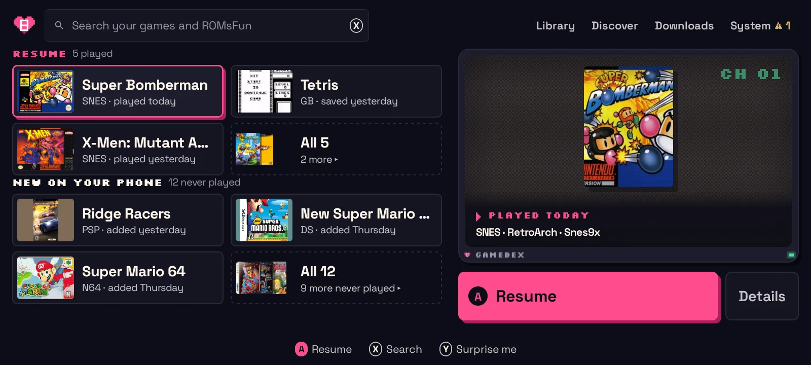

[Get the plugin prompt](https://jeffnash.github.io/GameBEX/#prompt) · [Download v1.0.0](https://github.com/jeffnash/GameBEX/releases/download/v1.0.0/GameBEX-1.0.0.apk) · [Play together](#play-together) · [Systems](#supported-systems) · [Build](#build-from-source) · [Docs](#docs) · [Legal](#legal)

## Your site. Our prompt. Your coding agent.

1. Open the [plugin prompt](https://jeffnash.github.io/GameBEX/#prompt) and enter
   the ROM site's address.
2. Paste the generated prompt into your coding agent. It reads the
   [source format](docs/source-schema.md), checks the site's public pages, and
   produces a `.source.json` file for you to inspect.
3. Import it under **System → Device → Game sources → Import source**. The site's
   catalog becomes browseable and searchable in GameBEX, with downloads and Play
   on each game's page.

Use the same prompt for different sites; each gets its own plugin. Popular doesn't
mean compatible: support depends on how the site works, and account-only sites
aren't supported. GameBEX ships no plugins, games, BIOS files, or catalog, and
doesn't operate, endorse, or verify the sites you choose. Your own game folders
work too, with no plugin required.

## What it does

### One library for every system

GameBEX scans its own `GameBEX/<system>/` folders on the SD card (or internal
storage) and any folders you add, including ES-DE-style layouts. Home shows what
you're playing and what's new; Library lists everything with filters, favorites
and each game's status.

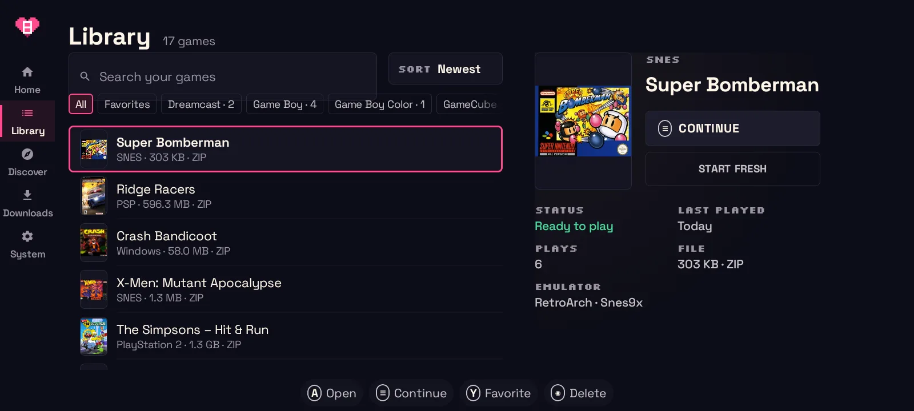

### Setup is GameBEX's job

Each system has a route: a RetroArch core or a standalone emulator. GameBEX
installs the emulator from a pinned, hash-checked build, fetches the RetroArch core
when it's missing, and tunes settings to your phone. Disc images are extracted and
checked before they boot, missing BIOS files are verified by MD5 when you ask for
them, and anything that still needs you says exactly what.

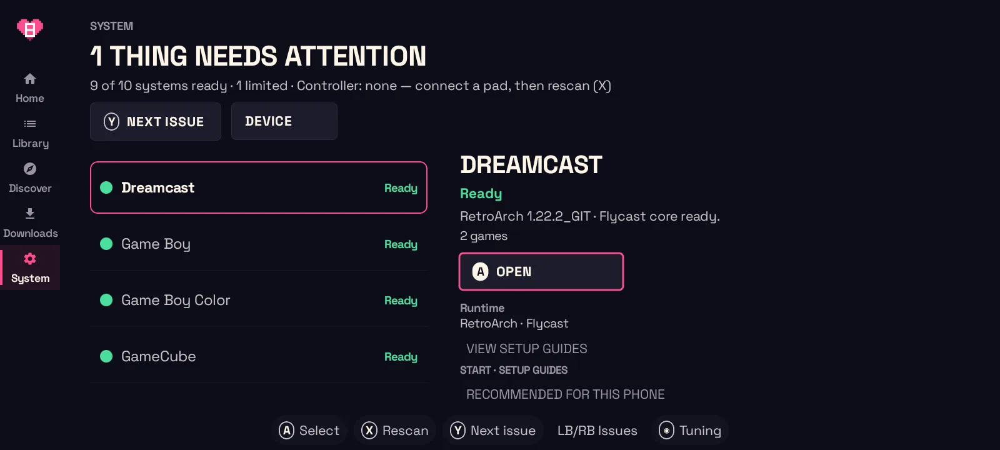

Controllers are set up in every emulator it launches: button mapping, touch
controls hidden, and Xbox, Nintendo or PlayStation button labels throughout.
[Shizuku](https://shizuku.rikka.app/) (optional) lets it configure the standalone
emulators Android otherwise keeps it out of.

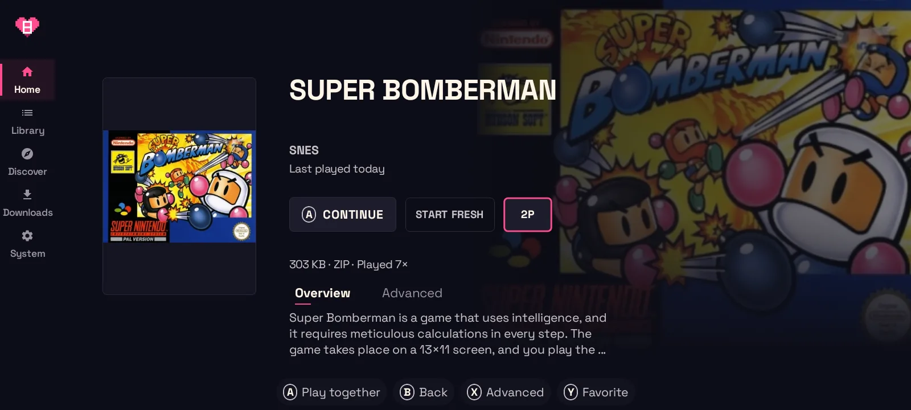

### Your catalog, inside your library

A source plugin is one data-only JSON file. Its games show up in Discover next to
the ones already on your phone, and Play downloads, prepares, and starts them.
Plugins can't run code, and removing one doesn't remove your downloaded games.

| Discover | Downloads |
| --- | --- |
| 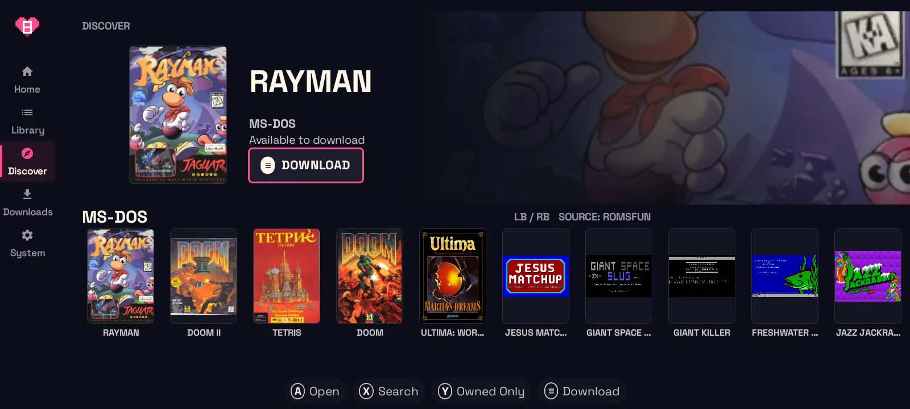 | 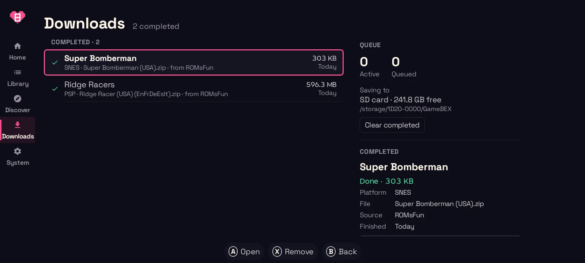 |

## Play together

**Couch co-op. Two phones. One game.** Press **2P** on a game and invite the other
phone on your Wi-Fi. With **Stream**, the host runs the game and the other phone
joins as player two. Only the host needs the game and its emulator.

Stream works across supported systems for games and emulators with local
two-player support, even without native netplay. Where a system already has
netplay, choose **Use Stream instead** on the host screen. The host needs Android
13+ and Shizuku; the joining phone needs Android 10+ and GameBEX.

Native netplay, Game Boy link, and PSP ad hoc are here too. Those modes run the
game on both phones; GameBEX gets missing games ready and matches RetroArch core
builds before starting.

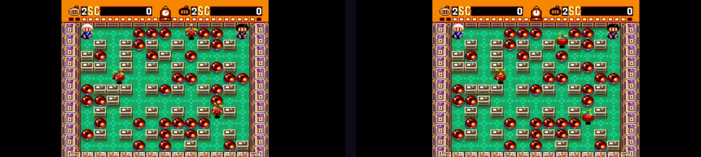

| Host | Join | Start |
| --- | --- | --- |
| 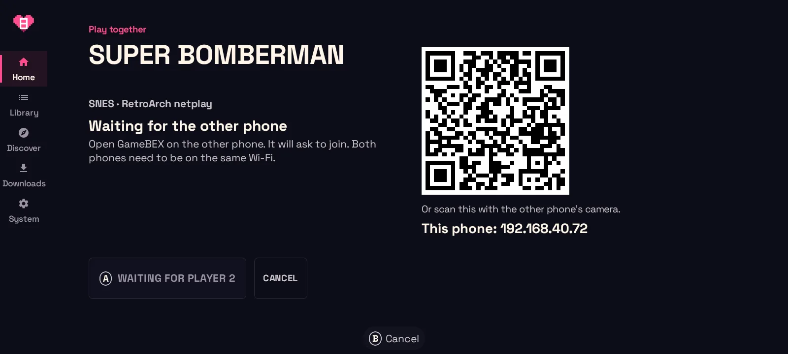 | 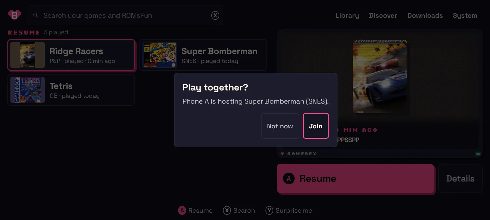 | 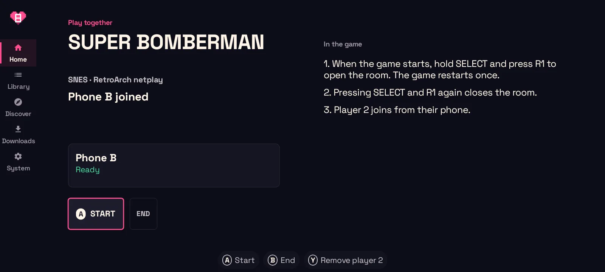 |

| Mode | Systems |
| --- | --- |
| RetroArch netplay | SNES, NES, Genesis, Master System, Game Gear, Sega CD, SG-1000, TurboGrafx-16/CD, arcade and Neo Geo (FBNeo) |
| Game Boy link | Game Boy, Game Boy Color (Gambatte's network link) |
| PSP ad hoc | PSP (PPSSPP) |
| Stream | Every system. Where a native mode above exists it stays the default and the host offers **Use Stream instead**. |

The joining phone can also find the host under **System → Device → Play
together**, scan its QR code, or type its address. Each phone shows a console name
you can change. Everything stays on your local network.

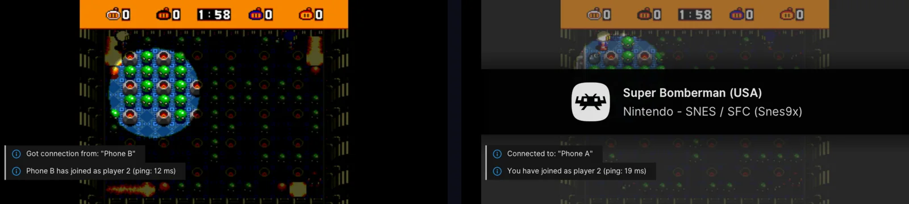

RetroArch netplay needs a RetroArch built on or after 28 July 2026. The 1.22.2
release crashes when the second phone connects, so GameBEX pins a tested nightly
and asks older installs to update. Full guide:
[Play together](https://jeffnash.github.io/GameBEX/docs/play-together/).

## Install

GameBEX isn't on the Play Store; you sideload the APK.

You need:

- Android 8.0 or newer (Android 11+ recommended), on a 64-bit ARM phone
- Landscape only (there's no portrait layout)
- A controller (D-pad plus A/B/X/Y); touch works too
- A microSD card is strongly recommended for disc images
- Optional: [Shizuku](https://shizuku.rikka.app/) for the full controller setup;
  required for Play together

Steps:

1. Download [GameBEX-1.0.0.apk](https://github.com/jeffnash/GameBEX/releases/download/v1.0.0/GameBEX-1.0.0.apk), or build it (below).
2. Allow the install when Android asks.
3. Open GameBEX and grant **All files access**. Without it, SD card folders are skipped.
4. Add games under `GameBEX/<system>/`, add your own folders in
   **System → Device → Game folders**, or import a plugin in
   **System → Device → Game sources**.
5. Install the emulators your games need from **System**.

## Getting started

- The rail on the left has Home, Library, Discover, Downloads and System; the strip
  along the bottom always shows what each button does.
- Open a game and press **A**. If something's missing, the button becomes
  **Finish setup** and tells you what it will do.
- **System** lists each system's readiness, with the next thing to fix first.

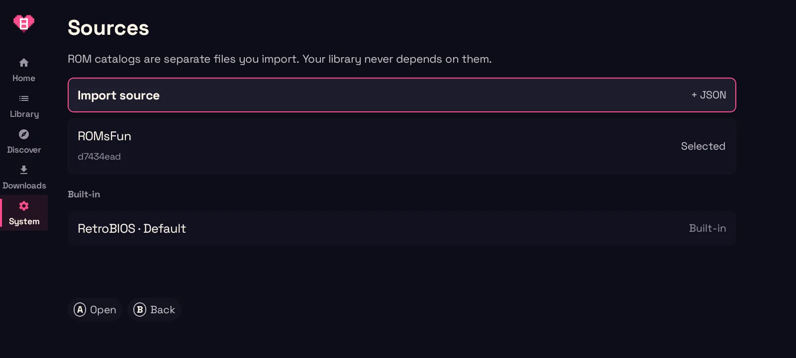

## Supported systems

54 systems, most of them in RetroArch.

| Systems | Runs in |
| --- | --- |
| SNES, NES, Game Boy/Color, GBA, Genesis, Master System, Game Gear, Sega CD, 32X, TurboGrafx-16/CD, and more | RetroArch (Snes9x, Mesen, Gambatte, mGBA, Genesis Plus GX, PicoDrive, Beetle PCE) |
| PlayStation, Saturn, Dreamcast, NAOMI, 3DO, Neo Geo CD, PC-FX | RetroArch (Beetle PSX, Beetle Saturn, Flycast, Opera, NeoCD, Beetle PC-FX) |
| Nintendo 64, Nintendo DS, Nintendo 3DS | RetroArch (Mupen64Plus-Next, melonDS, Citra) |
| GameCube, Wii | Dolphin (or the RetroArch Dolphin core) |
| PSP | PPSSPP (or the RetroArch PPSSPP core) |
| Arcade (MAME sets), Neo Geo (zips stay zipped) | RetroArch (FBNeo) |
| MS-DOS, Windows 3.x | RetroArch (DOSBox Pure) |
| PlayStation 2 | NetherSX2 (or ARMSX2) |
| PS Vita | Vita3K |
| ScummVM games, J2ME games | ScummVM, J2ME Loader |
| OUYA | installed as an Android app |

Where a standalone emulator exists (melonDS, Azahar, MAME4droid),
you can switch a game to it. GameCube and Wii default to Dolphin;
PSP defaults to PPSSPP.

Folder names and file types for every system:
[PlatformRegistry.kt](app/src/main/java/com/gamebex/client/data/PlatformRegistry.kt)
and the [systems docs](https://jeffnash.github.io/GameBEX/docs/systems/).

## Build from source

Requirements: JDK 17 and the Android SDK.

```sh
export JAVA_HOME=~/jdk17 ANDROID_HOME=~/android-sdk
./gradlew :app:testDebugUnitTest :source-runtime:test :app:assembleDebug :app:lintDebug
./gradlew :app:connectedDebugAndroidTest   # instrumented tests, on an emulator
./gradlew :app:assembleRelease             # R8 + resource shrinking
```

CI ([verify.yml](.github/workflows/verify.yml)) runs the unit tests, lint, and a
check that no site-specific catalog client lives in the app.

## Project layout

- `app/`: the Android app (UI, library scanner, disc prep, download engine, emulator
  routing, Play together)
- `source-runtime/`: the pure-JVM source-plugin interpreter and its policy checks
- `docs/`: architecture, formats, the source schema and legal notices

## Docs

- Website and user guide: https://jeffnash.github.io/GameBEX/
- [Getting started](https://jeffnash.github.io/GameBEX/docs/getting-started/),
  [Controllers](https://jeffnash.github.io/GameBEX/docs/controllers/),
  [Play together](https://jeffnash.github.io/GameBEX/docs/play-together/),
  [Source plugins](https://jeffnash.github.io/GameBEX/docs/source-plugins/),
  [Troubleshooting](https://jeffnash.github.io/GameBEX/docs/troubleshooting/)
- [docs/architecture.md](docs/architecture.md): how the modules fit together (start here)
- [docs/FORMATS.md](docs/FORMATS.md): formats and disc prep
- [docs/source-schema.md](docs/source-schema.md): the source plugin language
- [CONTRIBUTING.md](CONTRIBUTING.md): contribution rules

## Legal

GameBEX ships no games, no BIOS or firmware, no artwork and no ROM catalog. It's an
open-source frontend and library manager; emulation is done by third-party cores and
apps (RetroArch, Dolphin, PPSSPP and others), each under its own license. Only play
games and firmware you legally own. Source plugins are third-party files you choose
to import; this project doesn't operate, endorse or verify any of them, or the sites
they connect to. GameBEX isn't affiliated with Sony, Sega or Nintendo.

Screenshots show games from the author's own library.

Full notices: [docs/LEGAL.md](docs/LEGAL.md). Rights-holders with a concern can open
an issue.

## License

Copyright © 2026 Jeff Nash and GameBEX contributors.

GameBEX is free software under the [GNU Affero General Public License v3.0 or later](LICENSE).
You can use, study, share and change it. If you share a changed version, or let people
use one over a network, you have to offer them its full source under the same license
and keep the copyright and license notices.

The license covers the code, not the GameBEX name or logo. See [TRADEMARK.md](TRADEMARK.md).
