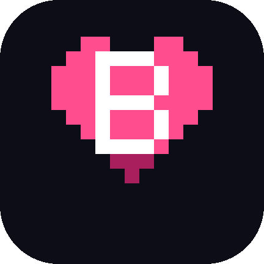

# GameBEX

**Your ROM site as a game library. Stream multiplayer across consoles.**

Browse a compatible ROM site's catalog with your controller, choose a game, and
download it when you want to play. GameBEX prepares its files, sets up its
emulator, and launches it on Android. With **Stream**, a second phone can join a
local two-player game; only the host needs the game and emulator.

**[Download v1.0.0](https://github.com/jeffnash/GameBEX/releases/download/v1.0.0/GameBEX-1.0.0.apk)** ·
[Quick start](#quick-start) ·
[Get the source plugin prompt](https://jeffnash.github.io/GameBEX/#prompt) ·
[User guide](https://jeffnash.github.io/GameBEX/docs/getting-started/)

- **A catalog bigger than your phone.** Our prompt and your coding agent make a
  plugin for a compatible ROM site. Browse and search it in GameBEX; download
  the games you want, when you want them. Your existing game folders work too.
- **Player two, across supported consoles.** Stream sends the host's picture and
  sound to another phone and brings its controller back as player two. Co-op or
  versus depends on the game and emulator supporting local multiplayer.
- **A ~$30 phone can be the handheld.** Built and tuned on Walmart's prepaid
  Moto G 2025. One setup command removes carrier clutter and installs GameBEX
  and Shizuku, without root.
- **Less setup between games.** Emulator installs, controller mapping, archive
  extraction, disc preparation, and launch in one place. When a step needs you,
  GameBEX says what to do. Navigate with a controller; touch works too.

| Browse your games | Play on two phones |
| --- | --- |
|  |  |

## Quick start

You need a **64-bit ARM phone with Android 8.0+**; Android 11+ is recommended.
GameBEX runs in landscape. A controller grip and microSD card are useful, but
neither is required. Bring your own games or source plugin; none are included.

1. Download the [v1.0.0 APK](https://github.com/jeffnash/GameBEX/releases/download/v1.0.0/GameBEX-1.0.0.apk)
   on your phone and open it. Allow your browser or file manager to install apps
   when Android asks. GameBEX isn't on the Play Store.
2. Open GameBEX and grant **All files access** so it can read your game folders.
3. Add your games: use `GameBEX/<system>/` on your microSD card, or add an
   existing folder under **System → Device → Game folders**. To browse a ROM
   site instead, [connect a source](#connect-a-rom-site).
4. Open **System** and install the emulators you need. For automatic controller
   setup in standalone emulators, enable [Shizuku](https://jeffnash.github.io/GameBEX/docs/controllers/#shizuku).
5. Open a game and press **Play**. If it shows **Finish setup**, select it to
   prepare the game; anything that needs your help is listed on the page.

The hint strip along the bottom shows the controller buttons for each screen.
No microSD card? GameBEX uses `Download/GameBEX/<system>/` in internal storage.
See [folder names and file types](https://jeffnash.github.io/GameBEX/docs/systems/).

[Release notes](https://github.com/jeffnash/GameBEX/releases/tag/v1.0.0) ·
[APK SHA-256 checksum](https://github.com/jeffnash/GameBEX/releases/download/v1.0.0/GameBEX-1.0.0.apk.sha256) ·
[Installation help](https://jeffnash.github.io/GameBEX/install/)

## Connect a ROM site

**Browse a site's catalog without leaving GameBEX.**
A source plugin describes how to read a site's catalog and download pages.
It's a data-only `.source.json` file, not executable code.

1. Open the [source plugin prompt](https://jeffnash.github.io/GameBEX/#prompt)
   and enter the site's address.
2. Paste the generated prompt into your coding agent. It uses the
   [source format](docs/source-schema.md) and the site's public pages to write
   a plugin. Check the result and the domains it accesses before importing it.
3. On your phone, open **System → Device → Game sources → Import source**.
   The catalog appears in **Discover**: browse, search, and choose a game to
   download and play.

Use the same prompt for different sites; each gets its own plugin. Compatibility
depends on the site, and account-only sites aren't supported. A generated plugin
can need changes when a site changes. Removing a plugin keeps downloaded games.

We supply the prompt, not the ROMs. Only download games you own and have the right
to download. Your source, your responsibility. At your own risk. ;)

[Importing and using plugins](https://jeffnash.github.io/GameBEX/docs/source-plugins/) ·
[Writing a source](https://jeffnash.github.io/GameBEX/docs/sources/)

## Play together: Stream across consoles

**Two phones. One game. Co-op or versus, without needing built-in netplay.**
Stream can share a game from any system GameBEX can launch. The host runs the
game and emulator; the joining phone receives picture and sound and sends its
controller input back. **Two-player control requires a game and emulator that
support a second local controller.**

| Requirement | Stream host | Joining phone |
| --- | --- | --- |
| Android | 13+ | 10+ |
| Install | GameBEX, the game's emulator, and [Shizuku](https://shizuku.rikka.app/) | GameBEX |
| Game files | On the host | Not needed |

1. Connect both phones to the **same Wi-Fi**, with the same GameBEX version.
   Start Shizuku on the host and allow GameBEX access.
2. On the host, open a game's page and press **2P**. Where a native mode is
   offered, choose **Use Stream instead**.
3. On the other phone, accept the invite, find the host in **Together**, or scan
   its QR code. When both phones are ready, start from the host.

GameBEX also supports **RetroArch netplay**, **Game Boy link**, and **PSP ad hoc**.
Those modes run the game on both phones and need their emulators and Shizuku
on both. For RetroArch netplay, use the build GameBEX installs from **System**;
the older 1.22.2 release crashes when player two connects.

[Session types, supported systems, and connection help](https://jeffnash.github.io/GameBEX/docs/play-together/)

## From Walmart box to GameBEX handheld

GameBEX was developed on the prepaid **Moto G 2025**, available for
[about $30 at Walmart](https://www.walmart.com/ip/14552506783). It works as a
Wi-Fi handheld without a mobile plan. Price and stock vary; the controller and
microSD card cost extra. Performance still depends on the game and emulator.

Finish Android's first boot, enable **USB debugging**, and connect and authorize
your Linux or macOS computer with adb installed. From a checkout of this
repository, run:

```sh
./scripts/moto-g-2025/setup.sh
```

It asks before removing carrier apps, ad installers, and preloaded games, then
installs GameBEX, grants its permissions, and installs and starts Shizuku.
No root or unlocked bootloader needed. Preview with
`DRY_RUN=1 ./scripts/moto-g-2025/setup.sh`.

Afterward, pair your controller, allow GameBEX access to Shizuku, and add games
or a source plugin. Shizuku needs restarting after a reboot.

[Setup instructions, options, and undo](scripts/moto-g-2025/README.md) ·
[The $30 handheld guide](https://jeffnash.github.io/GameBEX/docs/the-30-dollar-handheld/)

## Supported systems

GameBEX has emulator support for **54 systems** and recognizes 81 in the library,
including consoles, handhelds, arcade, and older computers. It uses third-party
emulators: RetroArch for many systems, Dolphin for GameCube and Wii, PPSSPP for
PSP, and others such as NetherSX2,
Vita3K, ScummVM, and J2ME Loader. Where alternatives exist, you can choose per game.

Recognizing a system doesn't guarantee it can run: some still lack an Android
emulator, and Vita games need importing inside Vita3K. The
[systems guide](https://jeffnash.github.io/GameBEX/docs/systems/) lists playable
systems, missing support, folder names, and file types.

**v1.0.0 known issue:** Wii and GameCube games may need controllers mapped once
inside the emulator; automatic setup is coming in an update.

## Help and documentation

| You want to… | Start here |
| --- | --- |
| Set up games, folders, or controllers | [Getting started](https://jeffnash.github.io/GameBEX/docs/getting-started/) · [Controllers](https://jeffnash.github.io/GameBEX/docs/controllers/) |
| Sort out archives, disc images, or BIOS requirements | [Formats and disc prep](https://jeffnash.github.io/GameBEX/docs/formats/) |
| Get past an error | [Troubleshooting](https://jeffnash.github.io/GameBEX/docs/troubleshooting/) |
| Report a bug or suggest a change | [GitHub issues](https://github.com/jeffnash/GameBEX/issues) |

For a bug report, include the GameBEX version, phone model and Android version,
emulator version, and steps to reproduce it. Jeff Nash and contributors maintain
the project here on GitHub.

## Build and contribute

Install **JDK 17** and the **Android SDK**. Set `JAVA_HOME` and `ANDROID_HOME`
to their locations, then build:

```sh
git clone https://github.com/jeffnash/GameBEX.git
cd GameBEX
./gradlew :app:assembleDebug
```

The APK is at `app/build/outputs/apk/debug/app-debug.apk`. To run the checks:

```sh
./gradlew :app:testDebugUnitTest :source-runtime:test :app:lintDebug
./gradlew :app:connectedDebugAndroidTest  # requires an Android emulator
```

The [verify workflow](.github/workflows/verify.yml) runs unit tests, lint, and
checks that site-specific catalog clients stay out of the app.
`./gradlew :app:assembleRelease` builds a release APK; signing requires your own
`GAMEBEX_RELEASE_KEYSTORE` and `GAMEBEX_RELEASE_PASSWORD_FILE`.

Read [CONTRIBUTING.md](CONTRIBUTING.md) before sending a pull request.
The Android app is in `app/`; the JVM source-plugin interpreter is in
`source-runtime/`. Start with [the architecture](docs/architecture.md),
[file formats](docs/FORMATS.md), or [the source schema](docs/source-schema.md).

## License and legal

Copyright © 2026 Jeff Nash and GameBEX contributors.
Free software under **AGPL-3.0-or-later**; see the full [LICENSE](LICENSE).
You can use, study, share, and change it. When you distribute a modified version
or offer it for use over a network, provide its source as the license requires.
The GameBEX name and logo are not covered by that license; see
[TRADEMARK.md](TRADEMARK.md).

GameBEX includes no games, BIOS, firmware, game artwork, ROM catalog, or source
plugins. Emulation is provided by third-party software under its own licenses.
Only use games and firmware you legally own and have the right to use. The
project doesn't operate, endorse, or verify the sites or plugins you choose.
GameBEX isn't affiliated with Sony, Sega, or Nintendo. Screenshots show games
from the author's own library.

[Full legal and third-party notices](docs/LEGAL.md)
